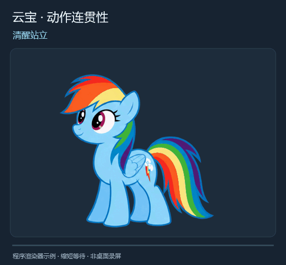

# 云宝桌宠 · Rainbow Dash Desktop

一款 Windows 桌宠。云宝会随着本机 Codex 的任务进度点头、翻书和庆祝，空闲时会在云上小憩。小圆环显示五小时和一周的剩余额度。



## 功能

- **任务动画。** 收到任务时抬蹄回应，处理中安静读书并偶尔翻页，任务完成后合书庆祝。任务中断也有独立动作。
- **日常互动。** 轻点头部会眨眼，点翅膀会整理羽毛。拖动时切换成冲刺，空闲时可选短程飞行。
- **桌面停靠。** 拖到屏幕边缘可以收边。全屏时可自动收边，透明区域允许点击下方窗口。置顶偏好会保存。
- **额度详情。** 外圈是五小时剩余，内圈是一周剩余。详情窗口显示两个周期的重置时间和最近同步时间。

## 构建与运行

需要 Windows 10 或 11，以及 Windows 自带的 .NET Framework C# 编译器和 WPF 组件。在仓库根目录打开 PowerShell。

```powershell
.\build.ps1
.\RainbowDash.exe
```

构建后的 `RainbowDash.exe` 从同目录的 `assets/` 加载动画。想先看演示，可以在退出正在运行的云宝后使用 `.\RainbowDash.exe --demo`。

## 常用操作

| 操作 | 效果 |
| --- | --- |
| `Ctrl + Alt + F10` | 在展开、收边和隐藏之间循环。也可从系统托盘找回云宝。 |
| 右键 → **减少动效** | 主要状态改用静态姿势，暂停自动飞行、目光和随机小动作。 |
| 右键 → **待机时偶尔短程飞行** | 开启同一屏幕内的待机飞行，默认关闭。 |
| 右键或托盘 → **查看额度详情** | 查看两个周期的剩余额度及同步时间，收边或隐藏时仍可从托盘打开。 |
| 双击额度环 | 请求刷新额度。 |

## Codex 同步

任务动画读取本机 Codex 会话事件。实时额度需要本机的官方 Codex CLI 已登录，由 CLI 处理认证并查询当前额度。查询暂时失败时，桌宠会尝试使用本机仍然有效的额度记录。缺少有效记录时，额度显示为「未知」。

偏好设置保存在 `%LOCALAPPDATA%\RainbowDashDesktop`。更多操作见 [使用说明](使用说明.md)。

## 开发与素材

`src/` 包含 C# 源码，`assets/` 包含动画帧、配置和制作记录，`tests/` 包含回归检查。在仓库根目录运行 `.\tests\run-tests.ps1`，各版验证结果见 [验证记录](验证记录.md)。

本项目为非官方同人桌宠。Rainbow Dash（云宝）及《My Little Pony》的相关权利归 Hasbro 及相应权利人。动画制作过程与参考来源见 [CREDITS](CREDITS.md)。
